Construo e mantenho software em produção, com atenção a autorização, confiabilidade e testes. Engenharia de Computação na UFRN, em Natal/RN.

**Em destaque**

- **[SellerScope](https://sellerscope.com.br)** · co-fundador, backend. SaaS com assinantes pagantes e três extensões na Chrome Web Store.
- **[SBSeg 2026](https://doi.org/10.5753/sbseg.2026.27136)** · coautor de *Protegendo Modelos de IA com GPUs Confidenciais em Nuvens Não Confiáveis*.
- **Edge4AI** · bolsista CNPq no laboratório Conect2AI (UFRN), IA executada no próprio veículo.

[Portfólio](https://leonardopcavalcanti.github.io/portfolio/) · [LinkedIn](https://www.linkedin.com/in/leonardocavalcanti-dev) · [E-mail](mailto:leopcavalcanti30@gmail.com)
