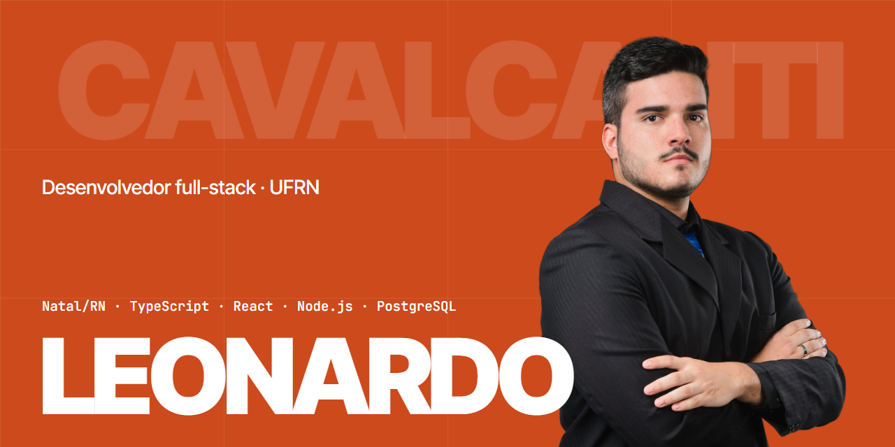

### Leonardo Cavalcanti · Desenvolvedor Full-Stack

- Construo e mantenho software em produção em Natal/RN; estudo Engenharia de Computação na UFRN.
- Co-fundador do **[SellerScope](https://sellerscope.com.br)** (backend) e bolsista CNPq no **Edge4AI**, laboratório Conect2AI.
- Coautor de **[Protegendo Modelos de IA com GPUs Confidenciais em Nuvens Não Confiáveis](https://doi.org/10.5753/sbseg.2026.27136)**, SBSeg 2026.
- Foco: aplicações full-stack robustas, com atenção a autorização, confiabilidade e testes.

#### Stack

#### Projetos

| | Projeto | O que é | Stack | Evidência |
|---|---|---|---|---|
| 001 | **SellerScope** | SaaS para vendedores de marketplace: três extensões publicadas, cobrança recorrente e acesso por plano no banco | Next.js · PostgreSQL · Chrome MV3 | [site](https://sellerscope.com.br) |
| 002 | **Conect2AI** | Site e painel do laboratório, com papéis, revisão antes de publicar e auditoria | Fastify · Prisma · Next.js | [case](https://leonardopcavalcanti.github.io/portfolio/#projetos) |
| 003 | **Intranet IA** | Conteúdo gerado por LLMs com failover entre provedores e fine-tuning | Fastify · React · Python | [case](https://leonardopcavalcanti.github.io/portfolio/#projetos) |
| 004 | **Zoonoses** | Estoque em tempo real com papéis de acesso e 2FA | React · Supabase | [demo](https://leonardopcavalcanti.github.io/zoonoses-inventory-dashboard/) · [código](https://github.com/LeonardoPCavalcanti/zoonoses-inventory-dashboard) |
| 005 | **EloBelle** | E-commerce com Next.js no front e Spring Boot no back | Java · Spring Boot · Next.js | [case](https://leonardopcavalcanti.github.io/portfolio/#projetos) |

#### Contato

[Portfólio](https://leonardopcavalcanti.github.io/portfolio/) · [LinkedIn](https://www.linkedin.com/in/leonardocavalcanti-dev) · [leopcavalcanti30@gmail.com](mailto:leopcavalcanti30@gmail.com)
